# 火眼金睛基于单光子检测与FPGA加速的材质识别系统

## 摘要

在反恐、战场侦察与要地防卫等任务中，金属装备与塑料、木质等材料制成的伪装目标常以相近的外形同时出现，仅凭可见光图像与人工判读难以与真装备区分；一旦判读失误，昂贵的精确制导弹药与处置力量会被直接消耗在假目标上。外观判据受光照、污渍与表面纹理影响，稳定性有限，而不同材料的反射回波强度、展宽与响应时延存在固有差异。本系统利用905 nm脉冲激光与FPGA时间测量构建光子时间分布测量平台，在固定距离下完成光子统计、模型训练与硬件推理，为真假目标的材质鉴别提供可验证的硬件基础。

系统以Zynq UltraScale+ MPSoC XCZU4EV为核心，将双通道折叠式时间数字转换器（TDC）、光子直方图统计与多模型推理集成于PL。TDC的折叠插值、双输出采样、计数编码与码密度校准参考文献[1]综述归纳的FPGA-TDC技术路线；HLS C++实现峰搜索、九维特征提取与分类。PS运行Linux和PYNQ，完成模型训练、数据管理及网页前端交互，形成采集、训练、部署与识别的一体化实验平台。

硬件采用共享直方图RAM与可更新参数架构：决策树和随机森林共用遍历电路，MLP与一维CNN分时调用同一乘加函数。公开数据包含88批次、1580帧和21种样品标签；固定15 cm遮光子集上，随机森林在640帧训练、160帧同批次留出诊断中达到99.375%。真实采集中PL随机森林特征与分类观测中位耗时为1.210 ms。完整设计布线后使用44031个LUT、82个BRAM Tile及35个DSP。

系统构建了测量参数可配置、训练数据可管理、模型参数可更新的片上学习与推理平台，支持多种模型在统一软硬件接口下训练、切换与执行。纸板、塑料和合金飞机模拟目标的真实采集识别验证了系统从光子时间统计到目标材质判别的完整处理链路，为基于材料响应差异的目标鉴别提供实验支撑。

关键词：单光子检测；折叠式TDC；Zynq UltraScale+；HLS；材质识别

## 第一部分  作品概述

### 1.1 功能与特性

（1）单光子时间直方图采集。　双通道TDC分别接收参考触发与探测事件，统计光子相对到达时间，形成65536点直方图。支持单帧、批量和连续采集，可重复观察微弱回波的计数与形状。

（2）板端训练与材质识别。　支持随机森林、小型MLP和一维CNN的板端训练，按任务配置训练批次与模型参数，训练后装载至对应推理路径。PS与PL使用同一特征定义及类别顺序，便于比较识别结果和执行耗时。

（3）测量条件统一配置。　参考触发可选外部信号源经LVDS接口输入，或由片内时序电路生成并回接；激光触发、低有效探测门控和比较阈值集中配置。多点距离校准辅助核对样品位置，固定距离实验保留峰位时移作为识别特征。

（4）实验数据与模型可追溯。　原始帧按批次保存，记录材质、实物、距离及光照条件；多个模型共用同一数据集。网页前端可选择训练批次、切换活动模型，并对多帧采集波形进行叠加或分图比较。

### 1.2 应用领域

（1）战场假目标与伪装目标鉴别。　充气坦克、复合材料飞机模型与充气雷达车等假目标在外形上与真装备高度相似，但材料为薄膜、泡沫、木材或复合材料，其反射回波的强度、展宽与峰位时移与金属装备存在系统性差异。该差异可作为外观判据之外的辅助特征，用于固定检测位上的真假目标初筛。

（2）反恐处突与可疑目标排查。　现场处置往往需要在不接触、不拆解的前提下判断可疑包裹、车辆夹层或自制装置外壳的材料类别。光子时间测量属非接触探测，可在受控距离下给出材质线索，为排查顺序与处置方式提供参考。

（3）装备保障与材料一致性核查。　备件、涂层与复合材料构件在入库或维修后需要核对材料是否与设计一致。固定工位上的非接触抽检可比较回波强度、展宽与时移，辅助发现替换、混料或表面处理差异。

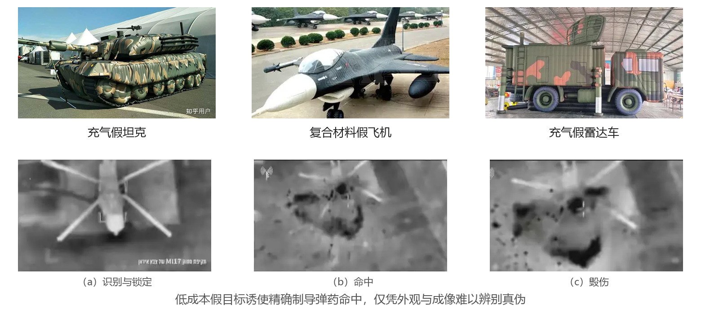

上述方向共享非接触测量、端侧计算与快速判读的需求，其共同前提是不同材料在时间分布上可以被稳定区分。本项目在固定距离、遮光条件下开展样品实验，验证测量链路与片上推理的可行性；面向实际场景的作用距离与复杂背景需要进一步扩展。

### 1.3 主要技术特点

（1）面向弱回波的时间表征。　时间相关单光子计数记录脉冲发射与光子事件之间的延迟，多次累积形成回波分布。相关研究已利用稀疏光子事件联合恢复深度与反射信息[2][3]。本系统将时间统计用于固定工位的材料响应表征，以强度、展宽和峰位共同描述样品差异。

（2）片内时间测量与统计。　利用折叠延迟链、双输出采样、计数编码和码密度校准形成双通道时间戳，在300 MHz测量域内完成事件配对与光子累积。直方图采用8 ps/bin分箱，为特征提取提供统一输入。

（3）可复用的PL推理结构。　九维特征由统一硬件入口生成，树类模型共用节点遍历，神经网络共用参数RAM及乘加函数。模型参数独立于bitstream，使同一Overlay能够承载不同算法与类别配置。

（4）跨开发方式协同。　RTL处理异步事件与确定性时序，HLS C++实现数值计算，Linux/PYNQ连接AXI硬件与Python训练。计算密集路径移至PL，PS负责数据管理与逻辑控制。

### 1.4 主要性能指标

表1-1 主要性能与配置

| 项目 | 参数或结果 | 依据 |
| --- | --- | --- |
| 核心器件 | Zynq UltraScale+ MPSoC XCZU4EV-SFVC784-1-I | 当前工程 |
| 时间直方图 | 65536 × uint32；8 ps/bin | 当前配置 |
| 时钟域 | TDC 300 MHz；HLS/AXI 100 MHz | 硬件配置 |
| 分类诊断准确率 | RF 99.375%；MLP 99.375%；CNN 90.625% | 同批次160帧留出 |
| PL观测计算耗时 | RF/MLP 1.210 ms；CNN 1.782 ms | 真实采集测量 |
| 资源使用 | LUT 44031；BRAM Tile 82；DSP 35 | 布线后报告 |

### 1.5 主要创新点

（1）测量、识别、训练与管理在单芯片内贯通。　PL完成双通道时间测量、光子直方图与特征分类，PS完成批次存储、模型训练和版本管理，网页前端统一控制。原始帧、训练参数和识别结果在板端形成闭环，外部终端承担交互与展示。

（2）多模型以共享硬件实现。　决策树与随机森林采用相同节点格式；MLP与CNN通过单实例乘加函数和2048×double参数缓存运行。完整系统使用35个DSP，占器件4.81%；直方图仅保留一份256 KiB RAM，按阶段复用。

（3）以时间特征补充强度特征。　在固定距离实验中，引入相对训练基线的回波峰位时移，与面积比、峰高比及展宽共同构成九维特征。在同批次160帧留出诊断中，随机森林与小型MLP均正确识别159帧，准确率均为99.375%。

（4）参数可更新的软硬件闭环。　系统采用统一数据与特征接口，支持训练批次选择、多模型训练、参数更新和版本切换，形成可随任务调整的板端训练与部署流程。模型切换通过装载参数完成。真实采集中，PL随机森林特征提取与分类的观测中位耗时为1.210 ms，热态推理识别中位耗时为11.107 ms，涵盖模型检查、数据准备及结果整理。

### 1.6 设计流程

设计先从激光触发、接收门控和参考事件的关系入手，确定可重复的测量条件；随后建立TDC与直方图链路，在Python端验证双峰定位和分类特征。HLS实现完成后逐层比较原始计数、特征与类别分数，再接入PYNQ完成板端闭环。

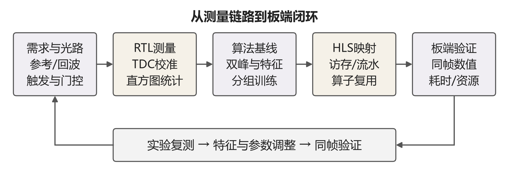

每轮优化同时检查识别结果、计算耗时与资源报告。测量条件变化时先检查输入分布，计算结构变化时先进行同帧数值对照，再开展真实样品实验。

## 第二部分  系统组成及功能说明

### 2.1 整体介绍

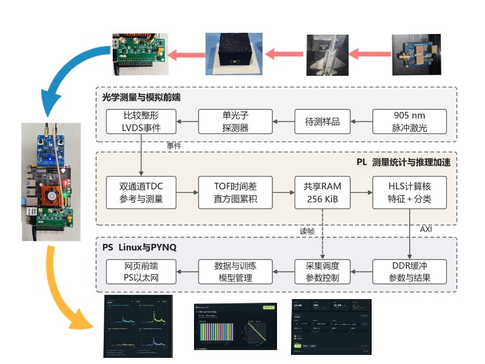

系统由光学测量前端、PL时间采集与推理、PS训练与交互三部分组成。脉冲光照射样品后，单光子探测器输出的电事件经比较整形进入FPGA，完成从时间量化到类别判断的处理。

（1）光学与模拟前端。　905 nm激光器提供探测脉冲，样品反射由单光子探测器接收，比较器形成LVDS事件。触发与门控协同限定每周期的发射和探测区间。

（2）PL测量与计算。　TDC输出参考及测量时间戳；TOF逻辑计算时间差并累积直方图；完整帧稳定后，HLS核读取共享RAM并执行特征提取和分类。

（3）PS训练与服务。　Zynq UltraScale+ MPSoC XCZU4EV的PS运行Linux和PYNQ，组织训练与参数装载，并通过PS以太网向网页前端发布波形和识别结果。

### 2.2 硬件系统介绍

### 2.2.1 核心板卡与比较前端

平台采用Zynq UltraScale+ MPSoC XCZU4EV开发板。PL连接双通道比较前端和双路DAC，PS提供Linux运行环境及以太网服务。板卡与外围模块的实际连接如图2-2所示。

    

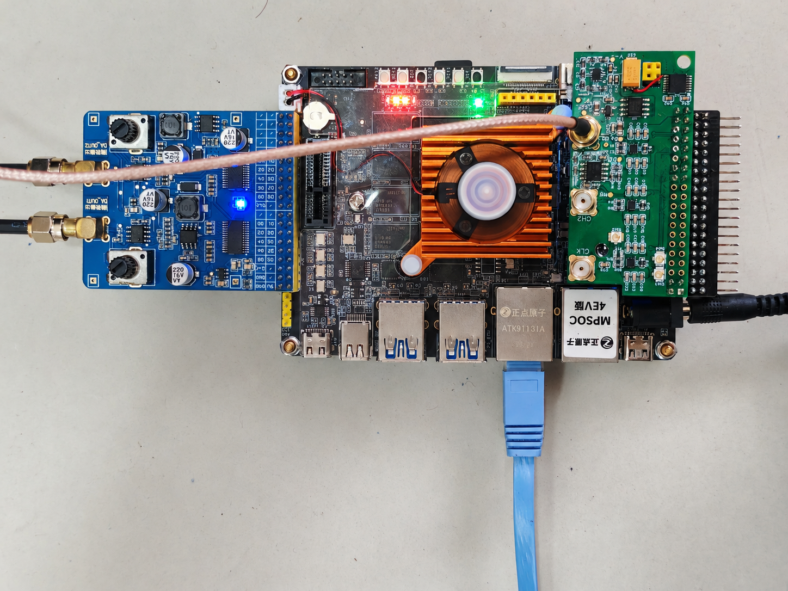

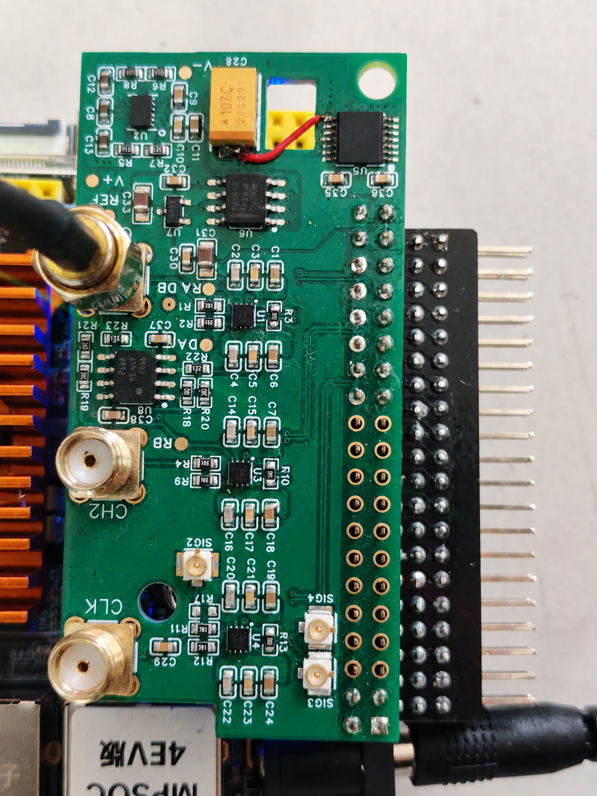

比较前端将探测脉冲与设定阈值比较，产生差分事件。测量输入连接C1/B1，外部参考连接B3/A3，经IBUFDS进入数字逻辑；内部参考由DAC1数字触发回接。默认比较阈值为0.300 V，阈值变化会同时影响有效计数和过阈时刻。

比较前端主板采用TLV5618双路DAC生成阈值，经OPA2188调理形成REF_OUTA和REF_OUTB，分别送入CH1、CH2比较支路。TLV3801将过阈事件转换为差分输出；前端供电与参考电压由独立电路提供。图中给出主板原理图的测量与阈值部分，完整五页电路图随工程提供。

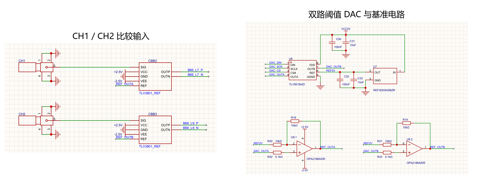

外部参考与探测事件由TDC进行异步到达时间量化，后续统计逻辑依据时间戳有效标志处理事件；控制参数则通过握手跨越时钟域，保证整组配置一致生效。

### 2.2.2 光学平台与触发门控

光源标称波长905 nm、重复频率100 kHz、光脉宽10 ns；探测器响应范围400～1100 nm，死时间20 ns。实验采用遮光箱、黑色植绒内壁与固定支架，主要在15 cm距离、样品正对和相同面积条件下采集。

  

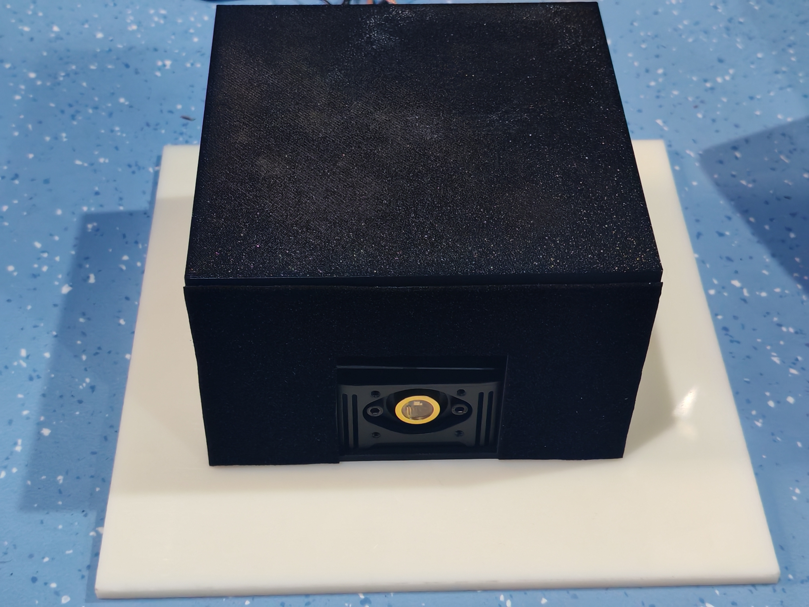

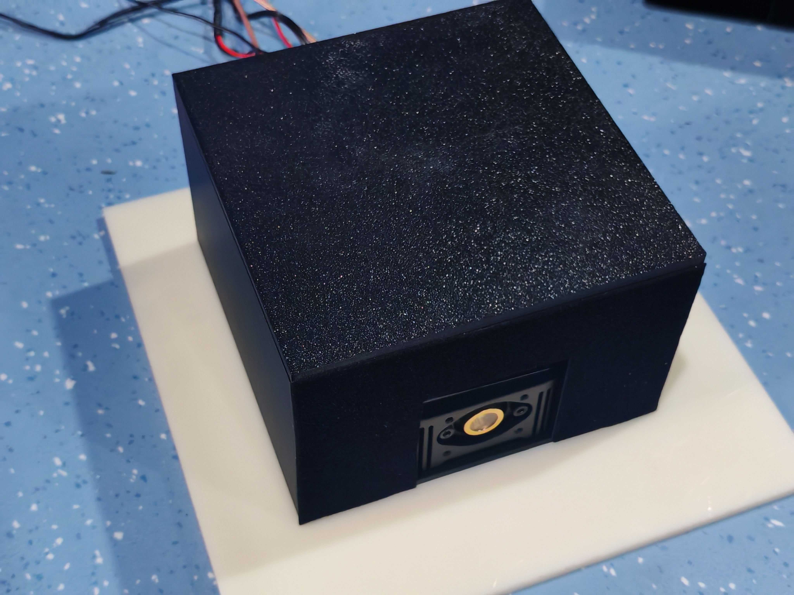

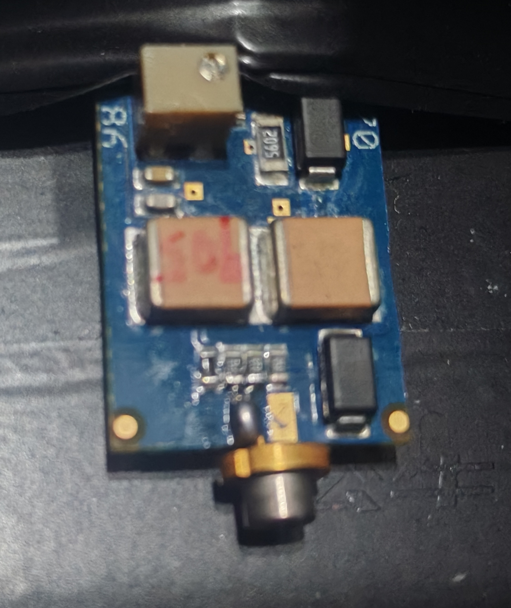

ATK-MO5651D V1.2双路DAC分别提供激光触发和接收门控，数字更新时钟125 MHz，对应8 ns配置步长。DAC1采用高有效触发；接收器在DAC2下降沿后开启、上升沿后关闭，因此门控按低有效窗口设计。

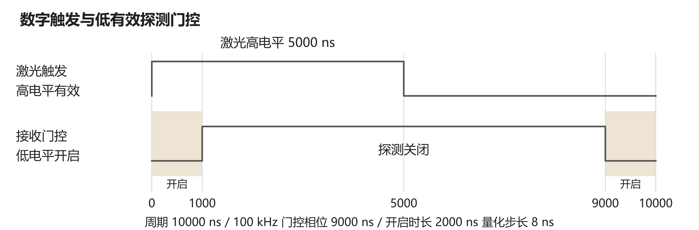

默认周期为10000 ns，激光高电平时长5000 ns，探测开启相位9000 ns、开启时长2000 ns，窗口跨越周期边界。电触发时长与10 ns光脉宽分别由触发配置和激光器响应确定。关闭输出时，激光触发保持低电平，接收门控保持高电平。

### 2.2.3 时间测量与折叠延迟链

双通道TDC量化参考触发和探测事件。粗计数记录时钟周期，细插值确定周期内位置，合成时间戳后送入TOF模块；测量与统计逻辑工作于300 MHz。

折叠插值与CARRY8双输出采样遵循文献[1]综述归纳的FPGA-TDC技术路线。CO、O抽头经极性处理和重排序进入编码器，以片内状态表征细时间。

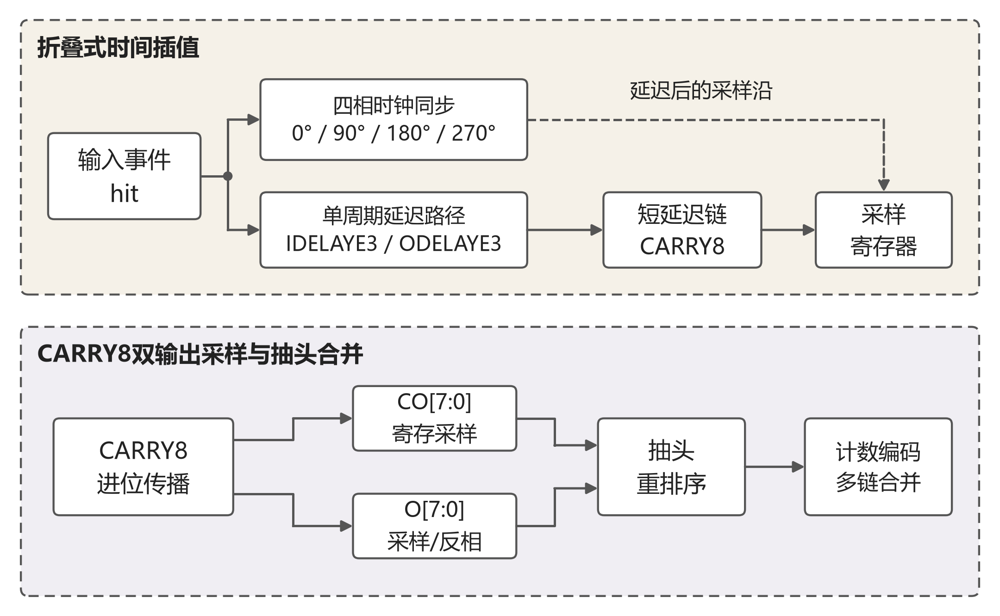

以参考和测量事件对应的下一采样沿粗计数为N₁、N₂，事件到该采样沿的细时间为τ₁、τ₂，时钟周期为T，则时间差为：

$$
\Delta t=(N_2-N_1)T+\tau_1-\tau_2 \tag{1}
$$

### 2.2.4 流水编码与码密度校准

编码器按组统计抽头中的“1”，以流水加法树归并，部分和与有效标志逐级对齐。

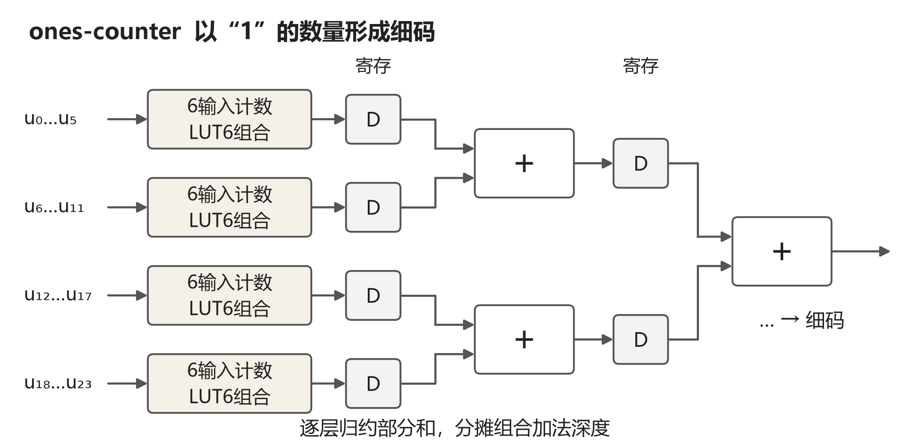

码密度校准统计异步激励的细码频次，以累计分布生成时间查找表。码频次Hₖ、总事件数N及有效插值区间Tᵣ确定码宽和中点时间：

$$
w_k=\frac{T_r H_k}{N},\qquad \tau_k=\sum_{i=0}^{k-1}w_i+\frac{w_k}{2} \tag{2}
$$

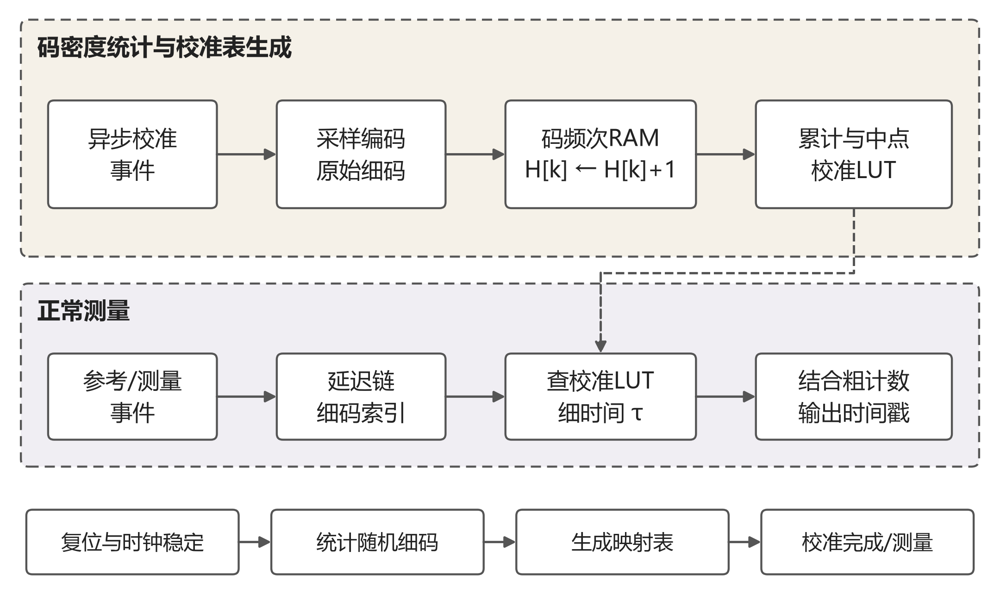

### 2.2.5 TDC集成与输出配置

TDC输出时间戳与有效标志，TOF将事件映射至统一格式的光子直方图。当前配置如下。

表2-1 本工程时间采集与直方图配置

| 项目 | 当前配置 | 核验依据 |
| --- | --- | --- |
| 采集通道 | 参考、测量双通道 | RTL顶层连接 |
| 测量与统计时钟 | 300 MHz | 时钟及BD配置 |
| 直方图分箱 | 8 ps/bin；65536 bin | 采集配置 |
| 直方图覆盖窗口 | 524.288 ns | bin数×分箱步长 |
| 单帧存储 | uint32计数；256 KiB | 共享RAM结构 |
| 常用累积设置 | 100000次参考触发/帧 | 当前采集参数 |
| 名义累积时间 | 100 kHz下约1 s/帧 | 触发次数÷频率 |

STARTUPE3的CFGMCLK经BUFG提供校准激励，两个通道完成校准后进入测量。8 ps/bin为直方图分箱步长；波形仍受激光、探测器、阈值和线缆响应共同影响。

### 2.2.6 TOF统计与直方图RTL电路

tof模块的timestamp1接探测事件D，timestamp2接参考事件。参考有效时，当前时间戳寄存器R₀更新，原值移入R₋₁；探测事件同样先寄存。START状态且探测有效、R₀非零时，比较D与R₀，通过2选1 MUX确定参考，再由64位减法器得到Δt。

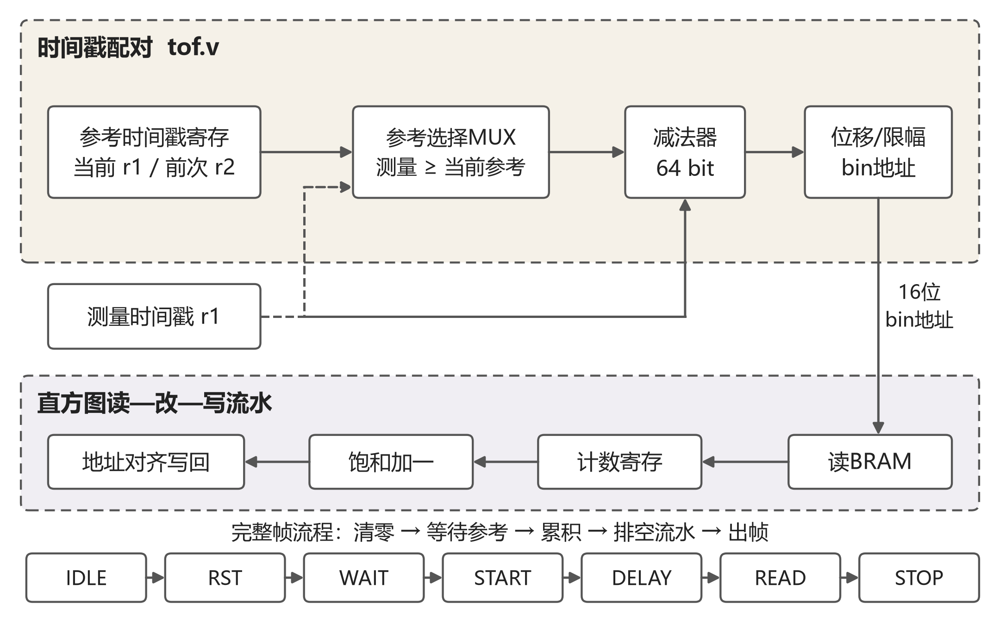

当D≥R₀时选择当前参考；当D<R₀时选择前次参考。后者用于处理两通道有效数据的到达顺序与时间戳顺序不一致的情况。该逻辑保留最近两次参考，要求参考事件持续有效，并在对应周期内解释探测事件。

$$
b=\min(65535,\Delta t[31:0]\gg s),\quad H[b]\leftarrow\min(H[b]+1,2^{32}-1) \tag{3}
$$

s为bin_width配置，当前对应8 ps分箱。RTL取时间差低32位右移并限幅为16位地址，超过地址范围时映射至65535。RAM B口读出原计数，经数据寄存器和32位饱和加一后写回A口；计数达到0xFFFFFFFF后保持。

计数数据与地址、使能分别寄存并对齐后写回，使RAM读出、加法和写回按流水推进。设计在BRAM读数据之后增加寄存级，缩短读出到加法的组合路径；写地址和使能随之延迟，保持对同一bin的更新关系。

帧控制依次经过IDLE、RST、WAIT、START、DELAY、READ和STOP。RST遍历清零，WAIT等待参考，START按有效参考累计trig_cnt；达到trig_num后进入DELAY排空计数流水，再顺序出帧。本地模式通过snapshot_valid、16位索引和32位计数发布65536个bin，完成后回到IDLE。

PS或HLS在完整帧稳定后访问同一份统计RAM。只有本地模式、状态为IDLE且没有新启动沿时，访问权才交给AXI侧；下一帧启动后由采集逻辑重新接管。该互斥机制避免推理期间原始直方图继续累积。

TOF时间差包含光传播、器件响应及线缆延迟。绝对距离需扣除系统固定延迟并经标准位置校准；材质识别主要使用固定距离下的分布形状与相对峰位。直方图8 ps分箱与DAC输出8 ns时序步长分别属于测量和控制通路。

### 2.2.7 AXI互连与共享直方图

直方图采用65536×32 bit双端口RAM，总容量256 KiB。采集阶段由TOF逻辑读写；帧稳定后，经AXI BRAM控制器交给PS或HLS访问。系统复用这份RAM作为历史回放与实时推理输入，减少大块存储复制。

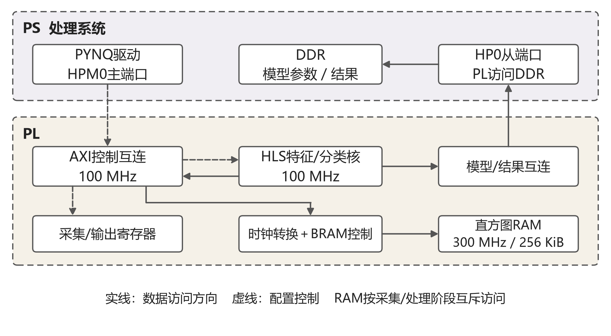

表2-2 关键AXI地址窗口

| 对象 | 基地址 | 用途 |
| --- | --- | --- |
| 直方图RAM | 0xA0000000 | 完整帧读取与回放 |
| 采集与输出控制 | 0xA0040000 | 启动、状态及参数 |
| HLS推理核 | 0xA0050000 | 指针、模型类型与完成 |

HLS通过AXI主接口访问直方图和DDR参数，结果写入连续DDR缓冲，PYNQ提供设备物理地址及缓存同步[4]。AXI控制与HLS运行于100 MHz，RAM端运行于300 MHz，跨域由时钟转换器及握手接口完成。

全PS模式读取原始直方图并在CPU上计算；PS加PL模式由硬件直接提取特征和分类，PS负责启动及结果发布。两种模式保持输入、特征顺序和类别定义一致。

### 2.2.8 PL特征提取的数据通路

峰搜索采用41点滑动和。首个窗口装入环形缓存后，每移动一个bin仅移除旧样本、加入新样本，累计值使用uint64，避免反复计算整窗。最大值比较严格使用“大于”，并列峰保持最早位置，与Python基线一致。

$$
S[k]=\frac{1}{41}\sum_{j=-20}^{20}C[k+j] \tag{4}
$$

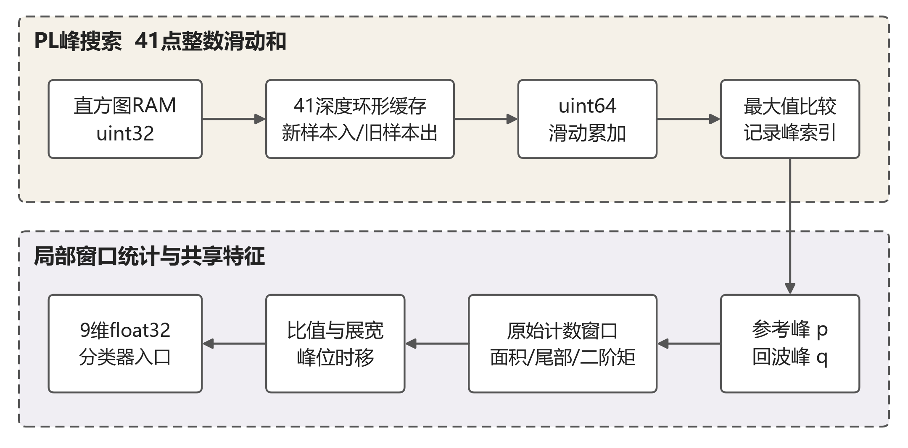

参考峰与回波峰定位后，HLS分别统计参考面积、回波窗口面积、前沿与尾部计数，并计算加权均值及中心化方差。半高跨度通过局部平滑曲线扫描得到；峰位时移由回波索引减去模型保存的基线形成。

面积特征使用原始整数计数，平滑用于选峰和相关形状量。九维输出统一转换为float32后进入分类器，树阈值与网络参数保持double表示，从数据类型和运算次序两方面约束软硬件一致性。

该实现采用有界窗口、环形缓存和顺序复用，在保留特征定义的同时减少重复访存。HLS综合时结合循环依赖、存储端口和算子数量确定调度[5]。

### 2.2.9 多模型共享推理与资源复用

随机森林和决策树均转换为节点表，节点保存特征索引、左右子节点、阈值及叶概率。树遍历硬件逐节点比较，遇到叶节点后累加类别分数；决策树作为单棵树使用同一路径。

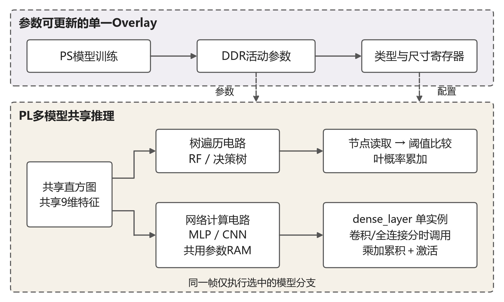

神经网络路径设置2048×double参数RAM，容量16 KiB。MLP的全连接计算和CNN的卷积、全连接均调用dense_layer，利用INLINE off及ALLOCATION limit=1约束为单函数实例，按输入和输出神经元顺序执行乘加。

模型种类、尺寸和参数地址由寄存器提供。同一帧只执行选中的分类分支；切换模型时更新活动参数，多个版本共用原始数据。硬件核支持最多64类、128棵树和16384个节点，实际网络形状受参数缓存与接口容量约束。

16类示例中，CNN打包参数为10352字节，MLP为9136字节。分时计算使完整设计仅使用35个DSP；这一资源结果包含TDC、统计、控制与推理模块，反映集成架构的整体占用。

### 2.3 算法与PS软件设计

### 2.3.1 回波定位与预处理

直方图前方窄高峰用于参考定位，较晚的峰对应目标回波。算法先在[512,30000) bin范围搜索参考峰p，再在相对参考峰[+2000,+20000)范围搜索回波峰q，并保留末端边界余量。

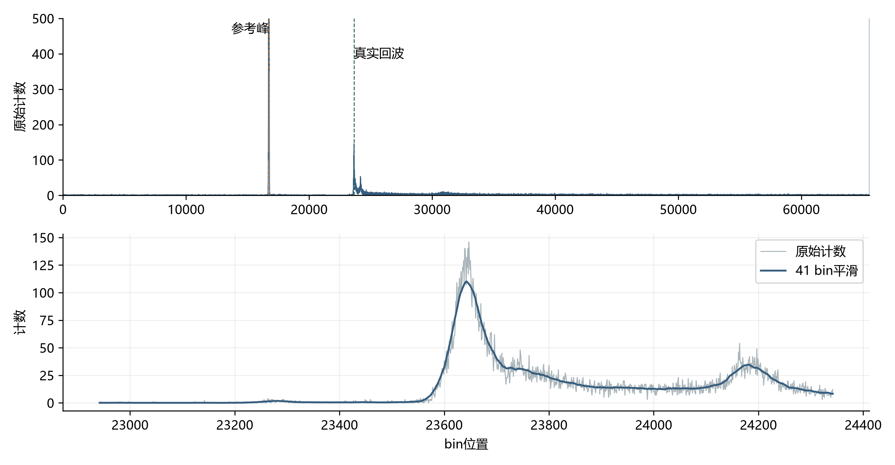

完整图采用线性坐标显示原始计数，局部曲线叠加41点滑动平均。选峰后保留原始波形用于面积和统计量计算；通过回波有效性与特征窗口完整性检查评估输入质量，并向控制层反馈异常状态。

特征以同一参考窗面积作为部分强度量的分母，减弱整体计数变化的影响；展宽和尾部比例描述波形形状，峰位时移补充时间位置差异。它们共同反映材料响应与测量链作用，实验中保持光路、触发和阈值条件一致。

### 2.3.2 九维特征与时间基线

记原始直方图为C[k]，平滑结果为S[k]，Aᵣ(x)为以x为中心、半径r且含端点的原始计数和。所有除数均设置不小于1的保护，特征顺序在训练、导出与PL推理中固定。

表2-3 九维特征定义

| 维度 | 数学定义或计算方式 | 表征内容 |
| --- | --- | --- |
| 1 | A₁₅₀(q) / A₁₅₀(p) | 局部回波强度比 |
| 2 | A₃₅₀(q) / A₁₅₀(p) | 宽窗回波强度比 |
| 3 | S[q] / max(S[p], 1) | 平滑峰高比 |
| 4 | A₅₀(q) / max(A₃₅₀(q), 1) | 核心计数比例 |
| 5 | ΣC[q+51:q+251] / max(ΣC[q−250:q−50], 1) | 尾部与前沿比 |
| 6 | q±500内半高首末索引差＋1 | 平滑半高跨度 |
| 7 | q±350内按计数加权的标准差 | 回波展宽 |
| 8 | S[q] / max(A₃₅₀(q), 1) | 峰高与面积比 |
| 9 | q − b₀ | 回波峰位时移 |

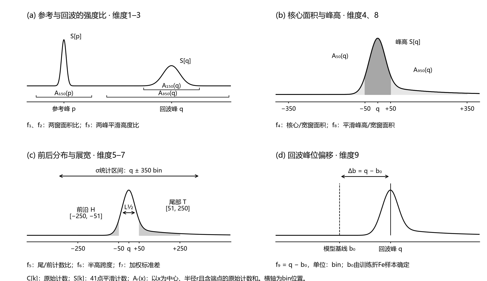

第5维采用Python左闭右开索引区间；第6维取局部窗内所有半高位置的首末跨度，因此多峰时包含中间间隔。第7维采用两遍中心化方差，PS与PL保持相同计算顺序。

峰位基线b₀优先由训练折中15 cm Fe样本的回波峰中位数确定，随模型参数保存。缺少对应Fe样本时记录零基线。固定基线让各材质保留相对时移；开机、阈值或光路变化引起的漂移，需要通过重新采样核对。

### 2.3.3 分类模型与训练方法

随机森林以九维回波特征为输入。训练时，每棵树从训练集有放回抽样，并在每个分裂节点从随机选取的特征子集中搜索使加权基尼不纯度下降最多的阈值。候选特征数按总维数的平方根取整，九维输入对应每节点三项。类别权重按训练样本频数反比设置，树数和最大深度可配置，分别调节集成规模和单树复杂度。推理时，各树按节点阈值逐层寻址，取得叶节点的归一化加权类别分布，再对各树分布等权平均[6]。若第 t 棵树对类别 c 的输出为 Pₜ(c|x)，则预测类别由式（5）确定。

$$
P(c\mid x)=\frac{1}{M}\sum_{t=1}^{M}P_t(c\mid x),\qquad \hat y=\arg\max_c P(c\mid x) \tag{5}
$$

MLP采用九维输入、32和16个神经元的两层全连接隐藏层，输出层宽度等于材质类别数。标准化参数仅由训练折估计，并直接用于验证和推理。两层隐藏层采用 ReLU 激活，输出层通过 Softmax 得到各类分数，以最大分数对应的类别作为预测。训练采用带 L2 正则项的多类交叉熵，默认以 L-BFGS 求解，正则系数 α 为 0.1，最大迭代次数为 2000[7]。该结构通过非线性映射学习回波强度、形状和峰位特征之间的联合判别关系。输入标准化与隐藏层计算见式（6）。

$$
z_j=\frac{x_j-\mu_j}{\sigma_j},\qquad h^{(l+1)}=\operatorname{ReLU}(W^{(l)}h^{(l)}+b^{(l)}) \tag{6}
$$

CNN从回波峰附近截取2048 bin，每8点求和得到256点波形，进行面积归一化后输入4个5点卷积核；ReLU及8点均值池化形成128维表示，与标准化九维特征拼接后，经8神经元隐藏层输出类别分数。

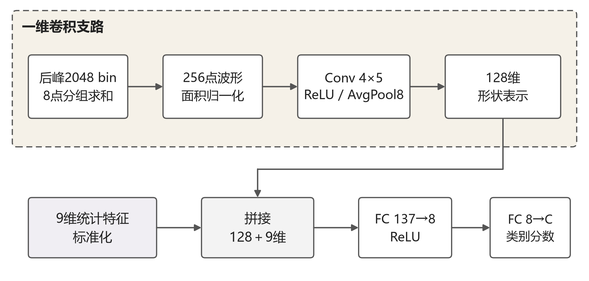

CNN训练在PS侧NumPy中完成前向和反向计算，交叉熵优化类别输出。波形支路学习局部形状，统计支路保留强度和峰位信息；三种模型在相同数据划分上评价，便于判断额外复杂度是否带来收益。

### 2.3.4 评价划分与部署

训练读取选定批次后，按实物、轮次和采集条件组织样本。具备多件实物时按实物分组留出；具备完整复测轮次时按轮次留出。单件实物且缺少独立轮次时，使用每个实物、距离和光照单元末20%帧进行诊断，并记录其划分范围。

标准化参数和峰位基线由训练折拟合，留出数据仅用于评价。完成诊断后，再以全部选中数据拟合部署模型，保存参数、类别顺序、特征配置及评价报告。连续帧留出用于观察同条件重复测量的可分性，跨批次能力通过独立组评价。

### 2.3.5 模型参数与PS及PL一致性

导出文件包含类别顺序、特征配置和峰位基线，以及树节点或网络权重。标准化参数与模型版本一并保存，切换时只装载活动模型；所有版本共用原始样本。

PS读取参数执行参考推理；PL按相同顺序取得九维float32特征，使用导出的阈值或权重计算。PYNQ负责连续缓冲分配、物理地址设置、缓存同步和完成检测，结果按同一类别顺序还原。

部署验证先比较参考峰、回波峰与逐维特征，再比较类别分数。固定输入与参数后检查两条路径的一致性，可将采集漂移、特征差异和分类误差分别定位。

### 2.3.6 多点经验距离校准

距离显示采用同一标准样品的多点校准。每个位置输入已知距离dᵢ，固定采集10帧，取回波峰位置中位数qᵢ；至少三个不同位置、总跨度不小于5 cm，以最小二乘拟合距离与峰位关系：

$$
\hat d=aq+b,\qquad (a,b)=\arg\min_{a,b}\sum_i[d_i-(aq_i+b)]^2 \tag{7}
$$

拟合残差反映标定点的一致性。样品位置可单独删除并重新拟合；启动状态、门控、阈值与接线变化后重新核对校准条件。

回波峰位同时包含传播时间、器件与线缆延迟，并随材料和过阈时刻变化。Fe标定对其他材质可能产生偏差，固定距离识别保留这种时移作为特征。

## 第三部分  完成情况及性能参数

### 3.1 系统实物与机械成果

系统已完成光机结构、比较前端、双DAC输出与Zynq UltraScale+ MPSoC XCZU4EV板卡的连接。遮光箱约束照明环境，样品夹具控制距离与角度，光学模块采用可拆卸3D打印外壳。

  

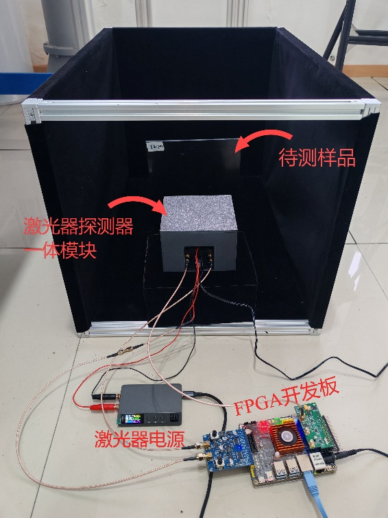

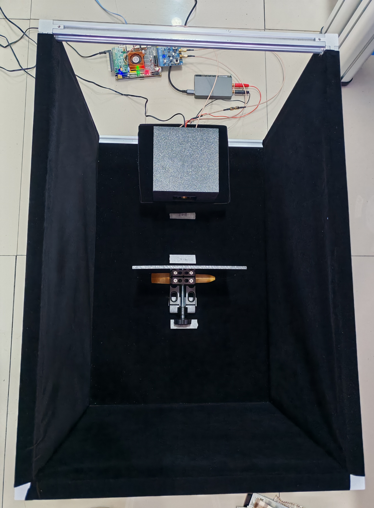

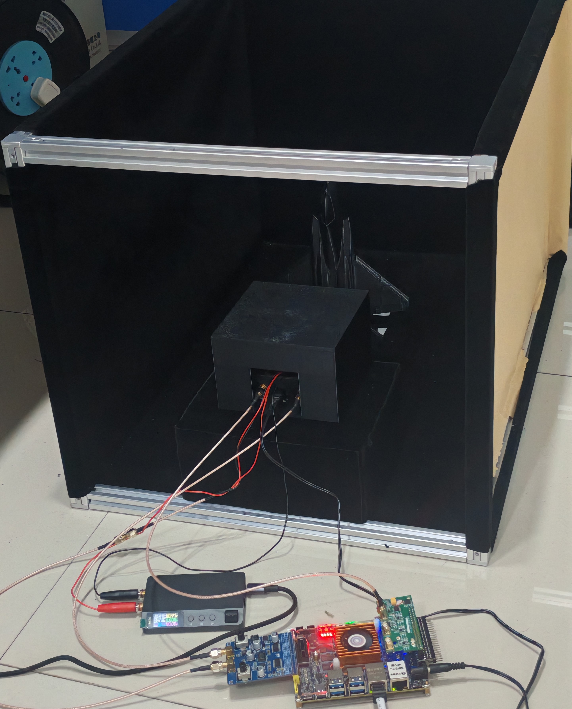

  

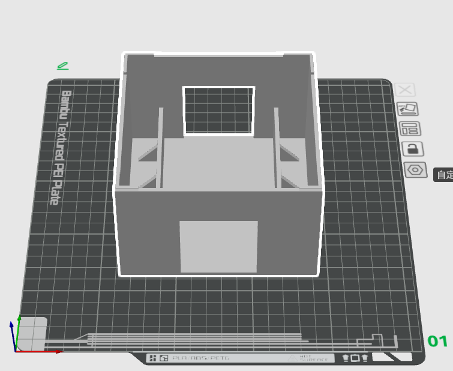

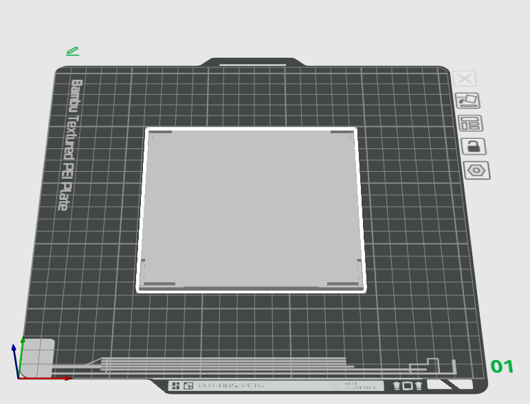

主体设置光路开孔与内部支撑，顶盖便于器件装配和检查。两份STL打印文件保存在src/mechanical目录，实物照片与模型图共同说明测量部件的装配关系。

### 3.2 板端软件与交互成果

网页前端将参数配置、采集识别、数据对比和模型训练集中于同一工作台。采集任务在板端执行，完成后发布原始波形、预测类别、类别分数及分段耗时。模型选择与PS／PL执行位置相互独立，可用同一输入检查算法和部署路径。

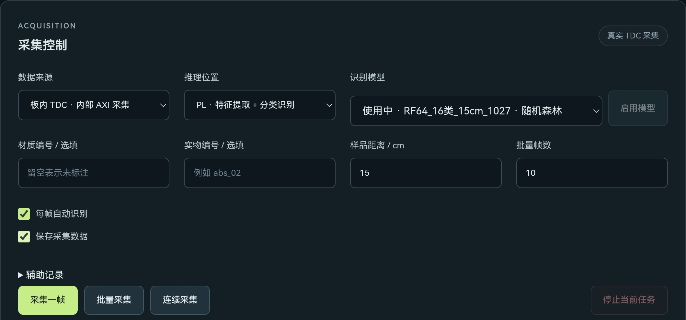

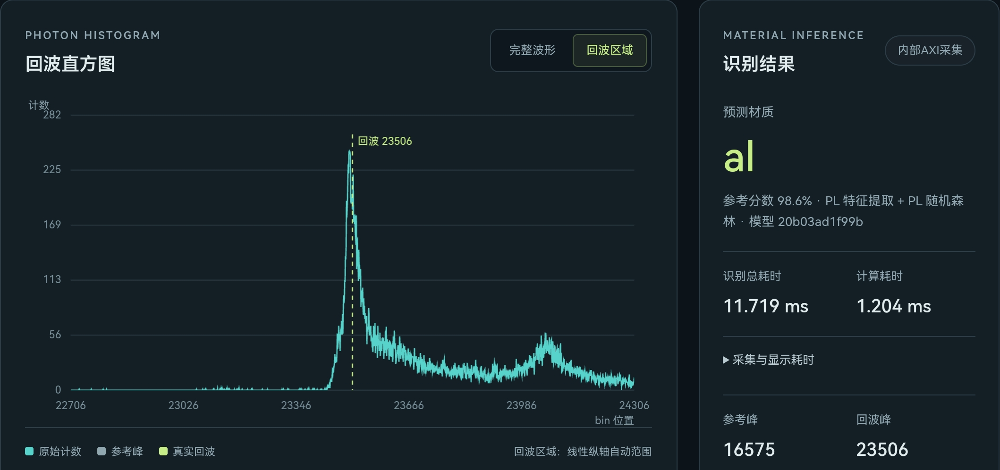

网页前端通过PS以太网访问服务，计算和数据保存均在板端完成。单帧模式显示波形与识别结果，连续任务保留逐帧记录；后台运行状态与结果发布分离，使参数浏览、任务进度和波形显示保持协调。

#### 模型训练与数据对比

训练界面按日期、材质和实物筛选批次，勾选后选择算法及超参数。训练完成生成独立版本，保存数据范围、类别顺序、诊断指标及PL参数；评价图按需生成。版本切换只装载活动模型，各版本共用数据集。

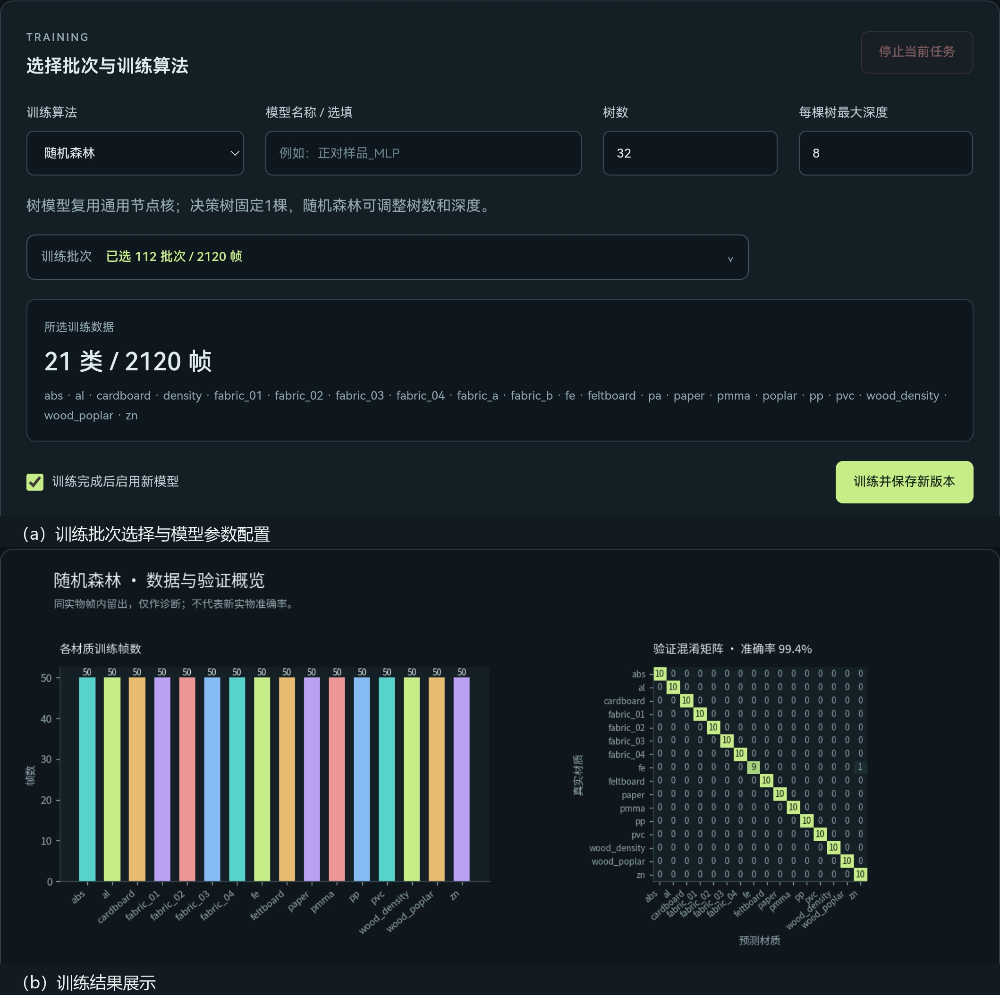

数据对比支持最多四帧，提供叠加波形与分图查看。回波峰位、前后峰间距、峰高比、面积比及半高宽并列显示，并标注相对首帧的差值，便于区分时间漂移、计数变化与形状差异。

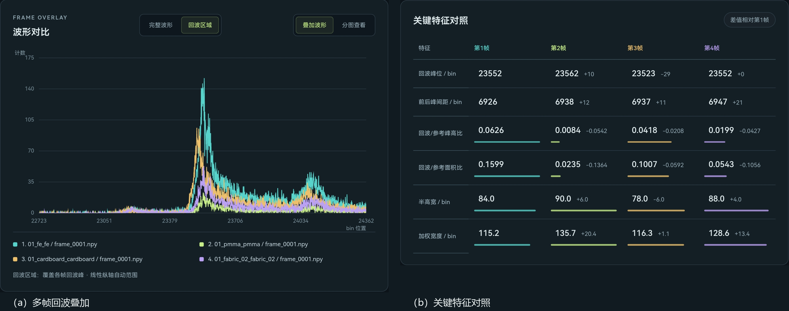

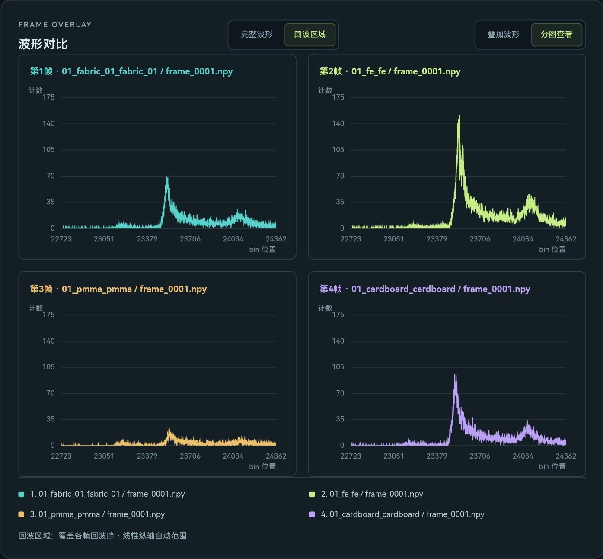

### 3.3 数据集与识别结果

公开数据快照包含88批次、1580帧，其中材质帧1400、背景帧180，覆盖21种标签。固定15 cm的三种光照条件用于辅助观察，模型比较选取遮光子集，共800帧、每类50帧。

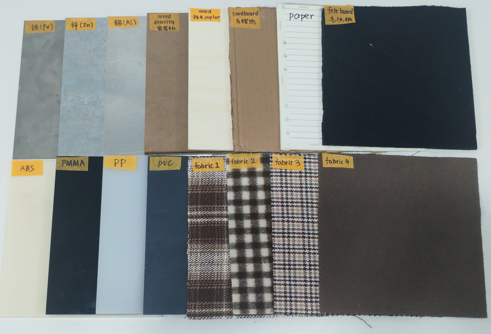

表3-1 公开数据组成

| 子集 | 材质帧 | 背景帧 |
| --- | --- | --- |
| 10～30 cm距离实验 | 600 | 60 |
| 固定15 cm三种光照 | 800 | 120 |
| 合计 | 1400 | 180 |

三份模型使用相同划分：各类末10帧留出，共160帧；其余640帧训练诊断模型。表中训练路径包含数据读取、特征提取、诊断训练和最终拟合，绘图单独处理。

表3-2 相同数据划分的模型诊断

| 模型 | 正确/留出 | 准确率 | 训练路径耗时 |
| --- | --- | --- | --- |
| 随机森林64棵 | 159 / 160 | 99.375% | 12.107 s |
| 小型MLP | 159 / 160 | 99.375% | 48.984 s |
| 小型CNN | 145 / 160 | 90.625% | 231.497 s |

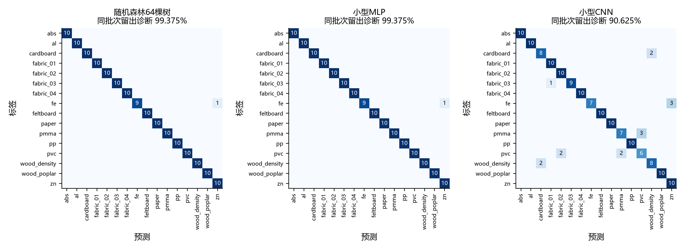

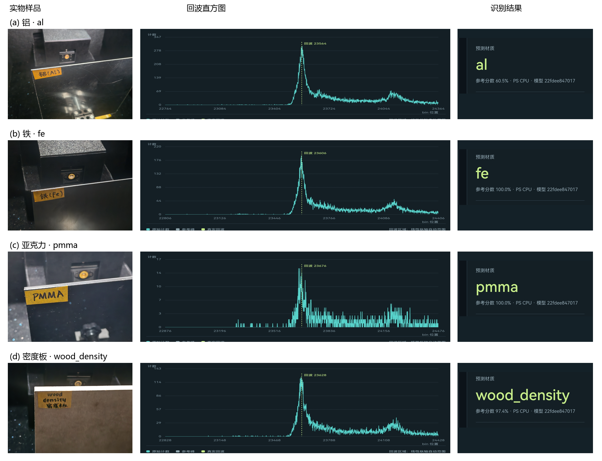

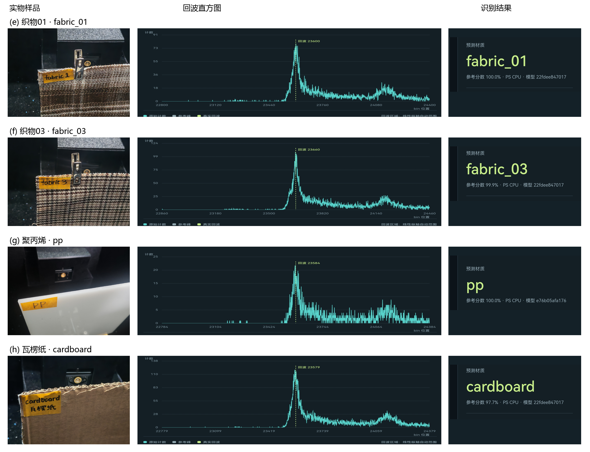

图3-9展示铝、铁、亚克力、密度板、两种织物、聚丙烯及瓦楞纸的真实采集实例，依次列出实物、回波波形与当前帧预测。截图采用PS CPU推理，聚丙烯与其余七项使用不同模型版本。各波形保留原有坐标及计数刻度，便于观察回波峰高、尾部形状和噪声差异；参考分数对应单帧预测，统计识别率见表3-2。

每类当前仅一件实物，结果描述同条件连续帧的诊断表现。随机森林的面积比350、峰高比、面积比150及峰位时移重要性约为0.275、0.222、0.214和0.038，说明强度与时移信息在该子集上均参与判别。

#### 飞机模型材质识别

选取纸板、合金与塑料三种飞机模型，在遮光箱内完成采集与识别。实物具有相近的飞机外形，材料组成与表面状态不同，适合将回波分布与直观的模型外观对应展示。

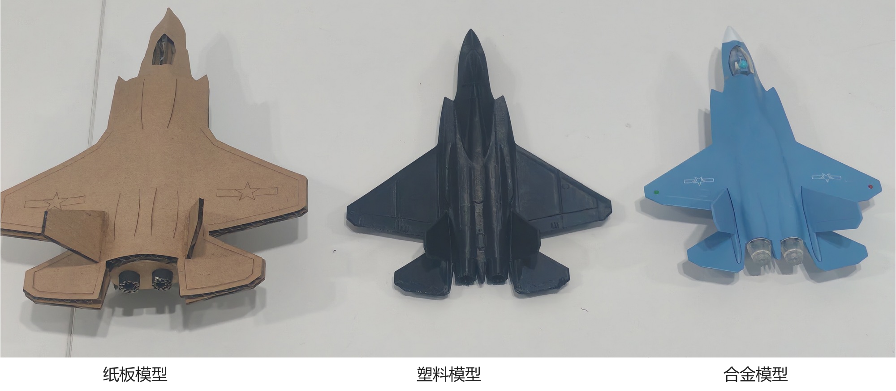

三类单帧实例使用同一随机森林模型，由PL完成特征提取与分类。纸板、合金和塑料模型分别输出paper、metal和plastic，参考分数分别为78.1%、59.4%和81.3%，PL观测计算耗时分别为1.205、1.209和1.212 ms。

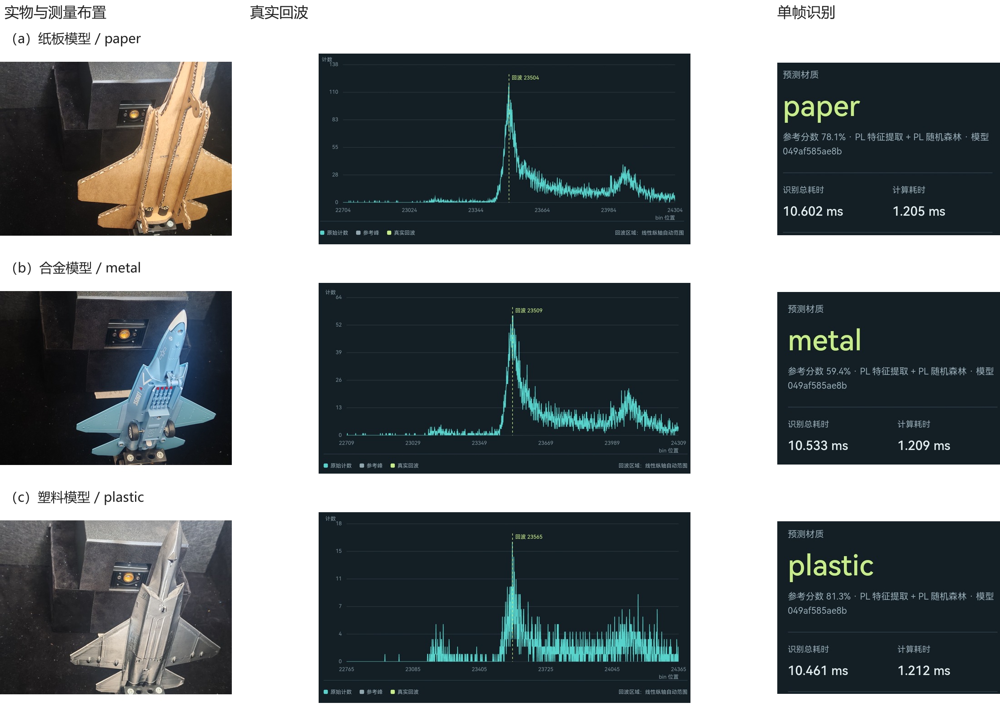

图3-12将三帧回波放在同一坐标系中，纸板、合金和塑料的回波／参考峰高比分别为0.0502、0.0238和0.0042，半高跨度分别为65、68和79 bin。该组样例中强度和展宽存在差异；单帧参考分数反映当前模型的判断，16类数据集的统计诊断结果仍见表3-2。

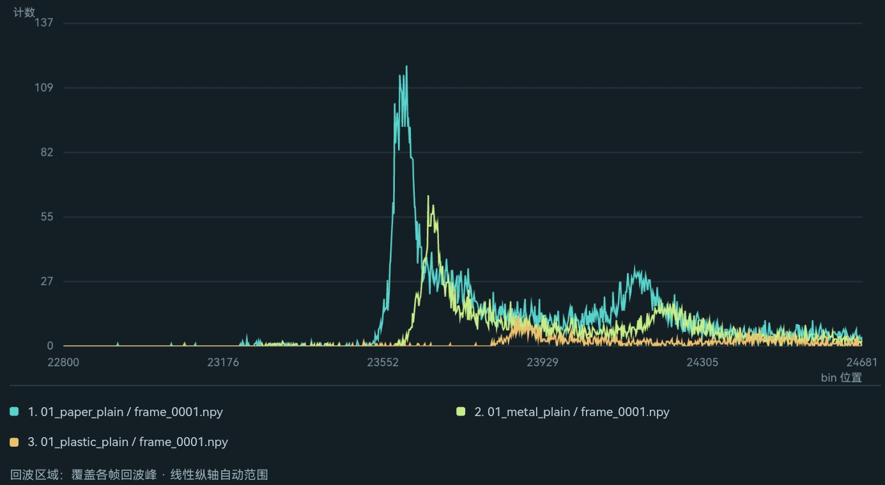

### 3.4 PS与PL的计算性能

全PS路径由CPU读取直方图并完成特征分类；PS加PL路径由HLS核直接读取共享RAM，执行特征提取和分类后向DDR写回结果。PL把重复窗口运算、树遍历和网络乘加从Python任务中移出。

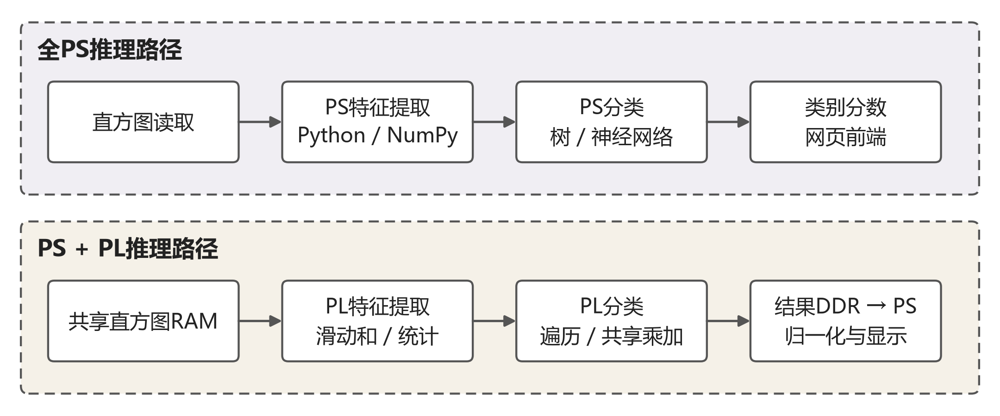

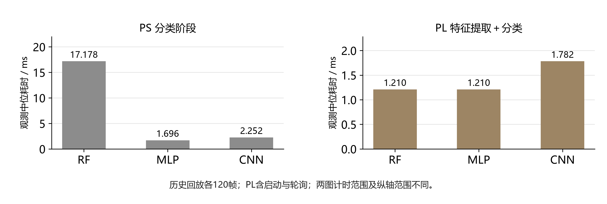

PS分类阶段从已提取的特征开始，PL阶段覆盖特征提取与分类，并包含PS启动和轮询观测。RF、CNN为九维版本，MLP为八维历史版本，各回放120帧。图中分别呈现测量范围，RF硬件路径表现出明显的耗时优势。

MLP和CNN在PS上采用矩阵运算，PL则通过单实例乘加函数分时执行，在35个DSP的完整设计预算内支持多种模型。当前实现以资源复用为重点，访存、串行计算和启动开销限制了小型网络的加速幅度。

#### 推理识别与交互响应

真实采集连续五帧均完成识别。首帧包含模型准备，后四帧推理识别耗时依次为10.635、11.578、43.527和10.608 ms，中位数11.107 ms。该阶段包含模型检查、输入准备、计算调用与结果整理，不包含光子采集时间与网页刷新时间。

100 kHz参考触发、每帧累积100000次时，光子累积约1 s，热态整帧处理中位数为1025.483 ms。分段计时将测量积分与计算分开，便于在保持有效计数的条件下评估推理及交互效率。

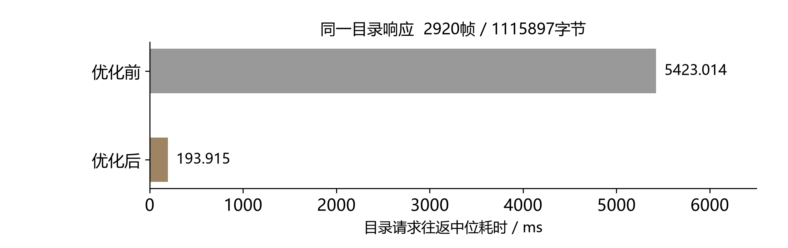

目录访问采用缓存和数据变化触发更新，减少逐帧扫描及锁等待。相同2920帧目录、1115897字节响应下，请求往返中位耗时由5423.014 ms降至193.915 ms，降低96.4%。

状态查询、波形更新和目录刷新分别调度；训练参数生成与评价绘图分离。轻量请求用于跟踪运行状态，波形只在新帧到达时更新，从而减少板端计算与通信的重复开销。

### 3.5 资源占用与实现验证

表3-3 布线后完整设计资源占用

| 资源 | 已用/可用 | 占比 |
| --- | --- | --- |
| LUT | 44031 / 87840 | 50.13% |
| 寄存器 | 51026 / 175680 | 29.04% |
| BRAM | 82 / 128 | 64.06% |
| DSP | 35 / 728 | 4.81% |

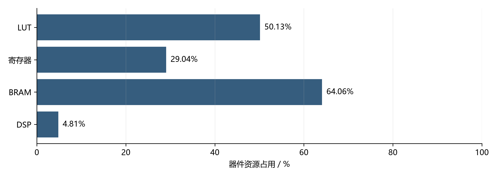

统计覆盖完整pynq_top。共享直方图避免额外复制256 KiB帧存储，树和神经网络采用分支及算子复用，保留DSP扩展余量。

为量化乘加单元复用效果，以同一顶层源码构造独立卷积函数与共享函数对照。两版采用Vitis HLS 2020.2、相同器件及10 ns目标周期，使用同一CNN历史帧进行C仿真和C/RTL协同仿真，88个结果槽均满足绝对误差1e-12。表中为HLS综合估算及该帧RTL周期数。

表3-4 共享乘加结构资源与周期对比

| 项目 | 独立函数 | 共享函数 | 变化量 | 变化比例 |
| --- | ---: | ---: | ---: | ---: |
| LUT | 35,403 | 32,547 | −2,856 | −8.07% |
| FF | 20,034 | 17,031 | −3,003 | −14.99% |
| DSP | 54 | 40 | −14 | −25.93% |
| BRAM_18K | 42 | 36 | −6 | −14.29% |
| 单帧周期 | 71,836 | 114,828 | +42,992 | +59.85% |

共享结构减少14个DSP及2,856个LUT，以更长的串行计算时间换取资源节省。两版HLS周期估算均为13.838 ns；单帧测试尚不能确定持续吞吐率。整板资源采用表3-3的布局布线统计。[实验脚本、层级报告、源码哈希及仿真日志](resource_optimization.md)随工程归档。

已分析路径的WNS为0.345 ns、WHS为0.013 ns，TNS与THS为0。约束检查另列未约束端点和I/O延迟告警，报告随工程保留，作为后续板级时序核验依据。

表3-5 分层验证结果

| 层次 | 覆盖范围 | 结果 |
| --- | --- | --- |
| 软件与网页 | 37项Python、5组JS检查 | 通过 |
| C++数值对照 | 4模型各120历史帧 | 特征误差为0 |
| PL历史回放 | RF、MLP、CNN各120帧 | 特征误差为0 |
| RTL模块回归 | AXI桥、直方图快照、双DAC、周期触发 | 4组通过 |
| HLS结构对照 | 两版同帧C仿真与C/RTL协同仿真 | 88槽一致 |

板端RF、MLP和CNN与Python对照的类别分数最大绝对误差分别为0、5.11×10⁻¹⁵和1.72×10⁻¹⁵。该验证支持既定输入和参数下的数值一致性。

### 3.6 工程交付与复现

开源工程按src、sim、build、board、data、skill和report组织，提供RTL、HLS C++、PS程序、HTML界面、构建脚本、bit/HWH、样本数据、模型参数及3D打印文件。技术报告与源码使用同一配置和特征定义。

表3-6 复现步骤

| 阶段 | 入口与检查重点 |
| --- | --- |
| 环境准备 | Zynq UltraScale+ MPSoC XCZU4EV；PYNQ 2.7；aarch64/Python 3.8 |
| 交付核验 | python3 board/verify_release.py |
| 软件部署 | board/install.sh；先使用历史帧与PS推理 |
| Overlay核验 | bit/HWH配对、地址及接口版本 |
| 实物采集 | 参考源、TDC校准、阈值与触发门控 |
| 软硬件对照 | 同一模型、同一帧的特征与类别分数 |

工程提供2020.2与2025.2两套构建入口，完成HLS综合、IP封装、BD生成与实现。2025.2交付脚本已通过完整编译及干净构建复跑，操作说明见build/README_2025_2.md。验证入口为sim/run_checks.py，结果保存于sim/results和build/reports。

### 3.7 工程方法与技能沉淀

项目归纳14项可复用技能，其中9项面向通用FPGA与软件工程，5项面向PYNQ；新增资源消融、AXI与CDC验证、HLS证据归档和共享缓冲生命周期检查，覆盖模型跨环境迁移、Overlay核验、数值对照、离线依赖、性能分段计时、模型生命周期、网页交互、周期输出、直方图特征及匿名交付。每项技能包含适用条件、操作入口与验证方法。

整体框架设计、关键代码逻辑设计、实验目标、样品采集、异常观察和方案取舍由本团队完成；AI辅助资料分析、程序实现、接口整理与测试。双峰辨别、激光幅值排查和固定距离方案均由实际测量推动，再通过逐层数值对照落实到软件和硬件。

## 第四部分  总结

### 4.1 完成情况与后续研究

本项目在Zynq UltraScale+ MPSoC XCZU4EV上完成了单光子时间采集、直方图统计、模型训练和PS/PL识别。折叠式TDC提供时间量化基础，共享RAM连接测量与推理，HLS复用结构支持多种模型，Linux/PYNQ将硬件能力组织为可操作的实验系统。

下一阶段重点增加独立样品和重新摆放轮次，以完整组留出验证泛化能力；同时分离强度、峰位时移和局部波形的贡献，明确哪些信息在跨轮次条件下仍然稳定。硬件方面可增加周期计数器，补充同帧、同模型、同计时范围的PS/PL比较，并研究定点化与访存调度。在应用层面，还需把测量距离由15 cm向米级扩展，评估背景光、大气衰减与假目标表面涂装对时间分布的影响，才能支撑实际场景下的真假目标鉴别。

### 4.2 心得体会

项目中最费时间的往往是解释一条看起来不正常的波形。采集数据中同时存在前方窄高峰和后方真实回波，特征提取必须保持二者的角色清晰。回波明显变弱时，我们团队检查了门控与触发条件，最终通过激光触发幅值找到输入链路的问题。这些经历使我们形成了先分析原始数据、再选择算法的研究习惯。

不同距离和不同轮次的数据混在一起训练后，模型表现并没有随数据量增加而稳定提高。重新固定距离、记录采集条件、按轮次比较，让问题逐渐变得具体：哪些变化来自样品，哪些来自摆放和系统延迟。能够复现一次测量，比单次得到较高识别率更有价值。

把算法搬到PL后，我们更关注每个数值的来源。峰位并列时取哪个点、面积窗口是否包含端点、输入何时转为float32，都会影响分类分支。逐帧对照虽然繁琐，却让训练程序与硬件计算真正保持一致。后续我们将继续用这种方式，把实验现象、算法选择和电路实现放在同一条验证链上。

## 第五部分  参考文献

[1] XIA H, YU X, ZHANG J, et al. A review of advancements and trends in time-to-digital converters based on FPGA[J]. IEEE Transactions on Instrumentation and Measurement, 2024, 73: 1-25. DOI: 10.1109/TIM.2024.3419091.

[2] KIRMANI A, VENKATRAMAN D, SHIN D, et al. First-photon imaging[J]. Science, 2014, 343(6166): 58-61. DOI: 10.1126/science.1246775.

[3] SHIN D, XU F, VENKATRAMAN D, et al. Photon-efficient imaging with a single-photon camera[J]. Nature Communications, 2016, 7: 12046. DOI: 10.1038/ncomms12046.

[4] PYNQ DEVELOPMENT TEAM. PYNQ Documentation 2.7: Allocate[EB/OL]. [2026-10-25]. https://pynq.readthedocs.io/en/v2.7.0/pynq_libraries/allocate.html.

[5] XILINX. Vitis High-Level Synthesis User Guide (UG1399), version 2020.2[EB/OL]. (2021-03-22)[2026-10-25]. https://docs.amd.com/r/2020.2-English/ug1399-vitis-hls/Basics-of-High-Level-Synthesis.

[6] SCIKIT-LEARN DEVELOPERS. scikit-learn 0.24.2: Ensemble methods[EB/OL]. [2026-10-25]. https://scikit-learn.org/0.24/modules/ensemble.html.

[7] SCIKIT-LEARN DEVELOPERS. scikit-learn 0.24.2: Neural network models (supervised)[EB/OL]. [2026-10-25]. https://scikit-learn.org/0.24/modules/neural_networks_supervised.html.
